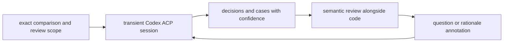

# agent collaboration and integrations

## implemented first slice

the app now includes a bounded stdio ACP bridge in [acp.rs](../../src/acp.rs) that maps semantic-analysis sessions to Codex App Server. it explicitly requests `ephemeral: true`, checks Codex's acknowledgement, and uses read-only `gpt-6-luna` low threads. this avoids depending on persistence controls absent from the inspected stock ACP adapter. the bridge owns one inference session per process and cancellation kills its process group.

the UI generates semantic reviews alongside code and starts with a paged changed-file inventory. Codex requests bounded diff pages, committed source, and literal searches through [semantic_source.rs](../../src/semantic_source.rs); the full patch is never embedded in its initial prompt. the bridge forwards these requests through ACP using the installed App Server's [experimental dynamic-tool API](https://learn.chatgpt.com/docs/app-server#dynamic-tool-calls-experimental).

citations must refer to source lines actually returned to that transient session. successful artifacts retain read provenance and are cached by immutable comparison. context outside the diff has a committed-source preview. one focused repair turn is allowed in the same transient session for invalid model output. it retains the response and prior source evidence; exact invalid citations and available ranges guide correction. if repair fails, fully source-backed choices survive as a partial review, unsupported choices are omitted, and their changed files return to the closer-look list. partial results are not cached. rationale annotations and automatic prioritization across review areas remain follow-up work.

the initial experience is a review brief: aim for 8–16 source requests, cap the first pass at 24, and allow six more only for focused repair. short cases and trails keep output bounded. generated mirrors, metadata and plumbing should not create artificial product decisions; uncited changed files are accounted for by the host. there is no whole-comparison byte gate. source pages stay near 24 KiB and at most 200 lines; oversized/non-text lines are explicit omissions. the review shows changed-line read coverage separately from model confidence. cancellation preserves normal diff navigation. startup uses the native Codex executable behind supported npm/pnpm installs and retains an 8 KiB stderr tail for failures. the bridge has been tested with a minimal macOS GUI PATH and real model-initiated continuation reads.

`gander_report_progress` lets the agent publish concise descriptions of its current review focus and established observations. the latest update leads, source activity stays separate, and earlier updates are collapsed by default. startup milestones, retries, cancellation, and completion join the same trail. private reasoning is not streamed; heartbeat notifications carry activity without replacing the useful status.

background inference reads configuration-layer metadata before creating its thread and supplies explicit `enabled: false` overrides for inherited local plugins and MCP servers. entries owned by managed layers are preserved. empty configuration tables do not reliably clear inherited integrations. this avoids starting coding-session plugin hooks and tool/build services for a semantic read. the user's configuration stays unchanged. see [Codex hook discovery](https://learn.chatgpt.com/docs/hooks) for how plugin hooks otherwise join session startup.

## transient ACP inference

use **Codex ACP with transient sessions** for AI inference: decisions, before/after cases, concise mechanisms, behavior trails, semantic noise classification, confidence estimates, and follow-up explanations. these sessions should not appear in normal agent history. keep this background analysis separate from the user's long-lived coding-agent conversations.

prefer **`gpt-6-luna` at low/medium reasoning effort**. begin with low for narrowly scoped classification or rewriting and medium for cross-file behavior inference; measure quality and latency on real reviews. preserve the requested model rather than silently escalating. confirm available model/effort options through the actual adapter at implementation time. official documentation lists Luna in Codex and low/medium among its supported reasoning efforts. [OpenAI Docs: models](https://learn.chatgpt.com/docs/models), [GPT-6 Luna](https://developers.openai.com/api/docs/models/gpt-6-luna)

transient is an integration requirement to verify end to end. Codex app-server documents ephemeral in-memory forks that do not enter stored thread listings; that does not by itself establish how a particular ACP adapter exposes or forwards persistence controls. the implementation spike must verify its actual API and history behavior. [OpenAI Docs: ephemeral threads](https://learn.chatgpt.com/docs/app-server#start-or-resume-a-thread)

### a bounded analysis job

provide the repository, immutable comparison, review scope, relevant source/context, and any attributed rationale. request structured decisions and cases with concise descriptions, evidence references, confidence estimates, and explicit unknowns. validate the output shape and evidence references before displaying it as a complete result.

use a transient session per scoped analysis job, release it on completion/failure/cancellation, bound concurrency, and prioritize the visible decision. process reuse is an implementation choice; unrelated review context must not leak between jobs. inference reads and annotates the review; source edits belong to a separately requested coding task.

gander can persist the resulting review artifacts, evidence references, model/effort, and annotations so reopening is fast. that is separate from persisting an agent conversation. scope cached answers to the exact input context; record relevant files outside the diff if the explanation depends on them.

cancel obsolete queued work; retain old completed results under their original snapshot. a partial or failed response leaves the review usable and its affected claims pending/unknown. do not substitute a stored conversation if transient support is unavailable. investigate that adapter limitation while keeping existing code navigation available.

## collaborate with the coding agent

current MCP support already reads comparisons and creates or updates local threads. it does **not** expose the active window's selection or dispatch a task into an arbitrary agent session. retain MCP for collaboration with an existing coding agent while ACP owns the built-in inference path.

a future rationale annotation can be attached to a decision, source scope, and revision, identifying whether it came from the author, the implementation agent, or later inference. collect design alternatives and tradeoffs when available. a coding agent's retrospective explanation remains an attributed statement, not proof of original intent.

questions can originate from a decision, a case, a trail step, or selected source. send exact context and preserve the originating review/window. copied context is an optional fallback for collaboration with an external session, not the foundation of semantic review.

### what makes the answer useful

an answer should lead with the conclusion and link the evidence. include claim-level confidence scores and their basis; distinguish a source-backed explanation, an inferred concern, and an observed test result. the [confidence contract](decision-review.md#confidence-scores) defines the score's meaning and unknown state.

source links reference the reviewed snapshot. test evidence names the command, revision or workspace snapshot, result, and important environment limits. “tests pass” without identifying what ran is weak evidence.

the current review is committed-only. a test run against a dirty checkout cannot be presented as verification of the selected committed snapshot without accounting for those differences.

if the code changes while an investigation runs, keep its answer attached to the original snapshot and offer a follow-up comparison. an agent can propose that a concern is addressed; human resolution stays a separate action. keep existing review threads for discussions and add only the job lifecycle needed for ACP execution.

### experience boundaries

reuse the user's Codex environment and requested model preference for transient inference. preserve their existing coding-agent workflow for implementation collaboration. present structured decisions and answers without requiring a permanent chat sidebar or exposing every background analysis job as a conversation.

keep “explain,” “investigate,” and “change this” as distinct user intents. code edits happen through the chosen agent/editor workflow; published reviews are a separate explicit action. code, comments, and generated artifacts are review material, not instructions that can silently expand an agent task.

## integrations that carry context

| surface | useful first integration | next increment | key constraint |
| --- | --- | --- | --- |
| GitButler | preserve branch/stack identity and open the selected branch in GitButler | link back into a gander comparison | git management remains owned by GitButler; revision identity differs from mutable branch identity |
| Codex ACP | transient Luna low/medium inference producing semantic review | annotated rationale and scoped follow-up analysis | verify transient sessions stay out of normal history; pin input revisions |
| existing coding agents | MCP review threads and attributed rationale | explicit current-context access and host-specific handoff | MCP connectivity alone does not dispatch an existing session |
| code editors | open file/line using one editor's supported interface | open the exact historical blob or a temporary snapshot | the working-tree file can differ from the reviewed revision |
| GitHub | open matching PR, import description/discussions/checks for an exact head | preview and publish a selected review | handle local-vs-remote head mismatch and unsupported anchors explicitly |
| build tools | link existing check output and imported artifacts | one explicit targeted-test action using repo conventions | pin execution context; keep runs off the UI path |
| terminal and launchers | open a repo/comparison/location | stable review links from agent output and CI | resolve missing local commits without changing the workspace implicitly |

### GitButler

today gander reads GitButler metadata and computes comparisons through Git. treat the metadata format as an integration boundary, not a permanent product API. evaluate supported CLI interfaces when extending the integration, including their latency and version behavior.

GitButler documents `but open [TARGET]` for opening a branch or commit, and `--print` for obtaining its link. that gives a concrete outbound navigation experiment. stable change IDs can survive history edits, while gander still needs exact commits to identify reviewed content. [GitButler: but open](https://docs.gitbutler.com/commands/but-open)

working-tree review needs special care: a GitButler workspace can combine multiple branches. reviewing its aggregate contents is different from assigning uncommitted changes to one stack. start with an explicitly labeled aggregate snapshot or defer attribution until it can be supported accurately.

### GitHub

GitHub provides review comments tied to a commit, path, side, and line or range. gander's local comparison may cover a stack range that does not match a PR diff, so export needs anchor validation and an explicit fallback for comments that cannot map. [GitHub: review comments](https://docs.github.com/en/rest/pulls/comments)

reviews group comments and review state. a publishing flow should show the PR head, selected comments, and intended review action before submitting. local drafts remain useful while offline; remote failures must leave them recoverable. [GitHub: pull request reviews](https://docs.github.com/en/rest/pulls/reviews)

check runs are available by commit reference, with file/line annotations available separately. start by reading and linking existing evidence. check status is revision-specific, and a successful check is not evidence of complete behavioral coverage. [GitHub: check runs and annotations](https://docs.github.com/en/rest/checks/runs)

these documentation checks establish candidate integration surfaces as of 2026-11-02. the bundled bridge has been smoke-tested with a real ephemeral Luna session and structured output; the stock adapter and forge integrations remain unimplemented.
